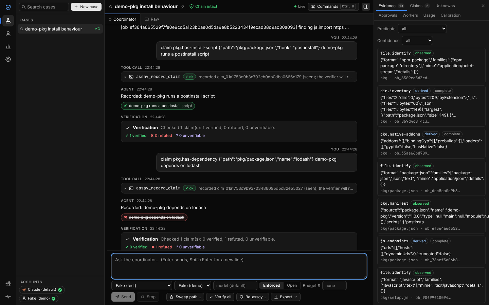
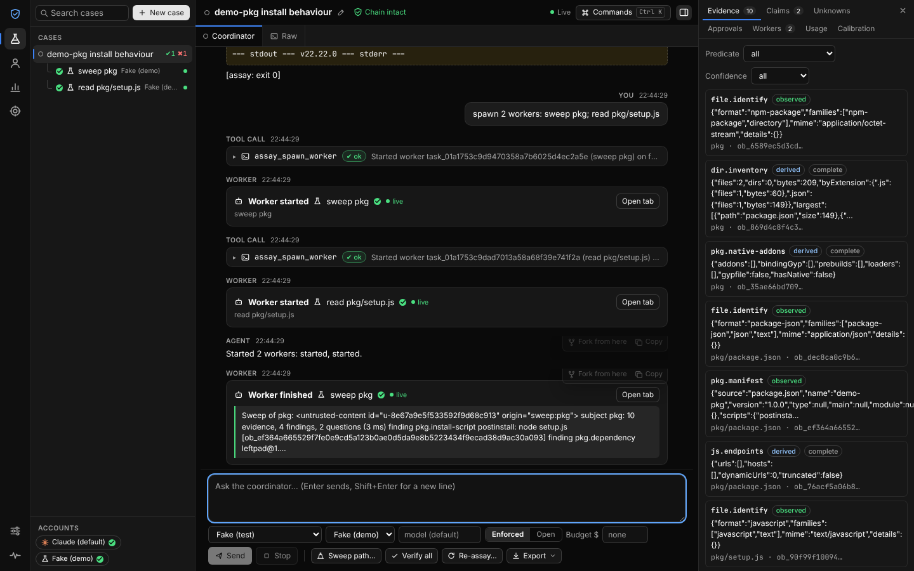
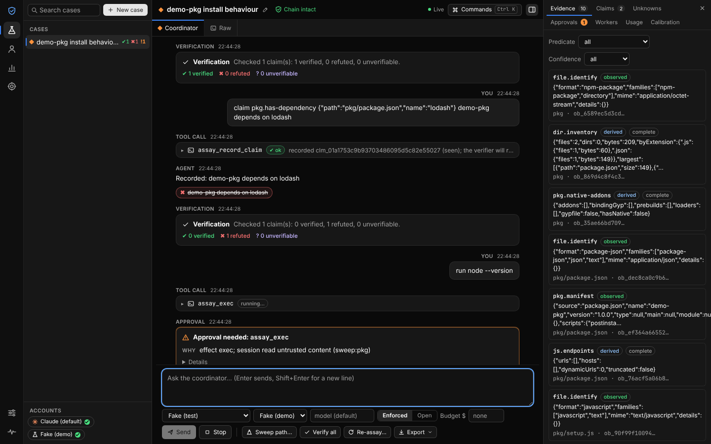
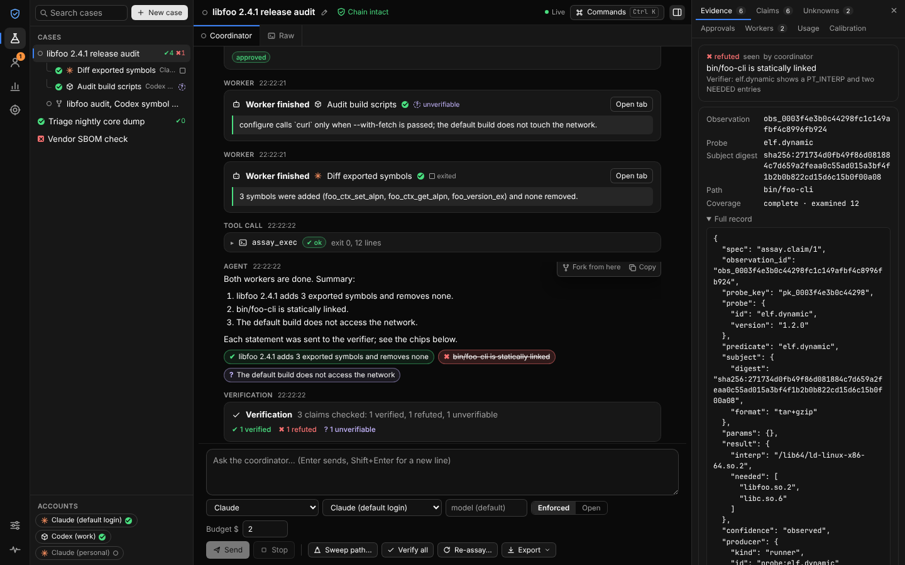

# Assay

**A local workbench for agents.** You chat with the agent clients you already have, signed in with your own accounts: Claude, Codex, or any Agent Client Protocol (ACP) agent. The agent can split work across sub-agents that run in parallel. Every factual claim it makes is re-run against evidence that needs no model, and is shown as ✔ verified, ✖ refuted or ? unverifiable. Investigations survive crashes, and can be rewound, forked at any step, and re-run against a new version.



Assay is the product that came out of the merger debate in [`docs/merger/`](../../docs/merger/). That debate took four repositories apart: leanrea, rea, pi-durable and absurd. Assay keeps what each does well and fixes the defects the debate measured. It adds the sub-agent model and interface layout from Orca, and the delegated sign-in from T3 Code.

| From | What Assay uses | What Assay fixes |
|---|---|---|
| **absurd** | Task, run and checkpoint state machine; leases; first-write-wins checkpoints; events | Expired leases accepted writes; event names misfired when reused. Assay adds a write fence and sequenced topics, on SQLite |
| **pi-durable** | Intent recorded before each effect, with replay policies; crash-loop parking; request dedupe | Two processes silently overwrote each other. Assay locks the store to one process and mints ids fresh on every call |
| **rea** | Evidence and unknowns model; effect classes; confidence classes | Ids changed with the path and depended on the output; "complete" coverage meant only "not truncated"; a 3.2 MB tool catalog. Assay uses three keys, an honest coverage census, and a 7.6 KB catalog |
| **leanrea** | Router table, as data; trap list; seen/inferred/unknown labels; budgets | Its rules lived in prose only. Assay enforces them in code, and checks every row with a fixture |
| **Orca** | Workers in their own git worktrees, receipts, mailbox, circuit breaker; process host; interface layout | — |
| **T3 Code** | Sign-in through the official client in a separate home per account; pairing; untrusted-content envelope | Reading other apps' credentials and calling private endpoints are *not* adopted |

## Quick start

```bash
cd apps/assay
npm ci && npm run build      # Node 22.12+
node bin/assay.mjs serve     # prints a one-time pairing link; open it in your browser
node bin/assay.mjs serve --demo   # adds a deterministic fake agent, so you can try it with no account
```

The first-run wizard does five things:
1. finds your installed clients (`claude`, `codex`, ACP agents);
2. runs each one's **official sign-in** in an account home of its own;
3. lets you pick a folder, file or package to work on;
4. offers recipes: investigate a package, audit a desktop app, compare versions, review a change, coding task with checked tests;
5. opens a case with that recipe.

Model-free features need no account and no network:

```bash
node bin/assay.mjs sweep path/to/package       # findings, open questions, what was not examined
node bin/assay.mjs probe file --probe elf.info
node bin/assay.mjs verify --bundle case.bundle.json
node bin/assay.mjs doctor
```

## What it does

- **Chat with your own accounts.** Assay drives the official clients (Claude Agent SDK, `codex app-server`, ACP) and stores **no model credentials**.
  - **Enforced** mode gives the client only Assay's tools.
  - **Open** mode keeps the client's built-in tools, and the interface labels it "unenforced".
- **Sub-agents.** The coordinator starts workers with `assay_spawn_worker`. Each worker can run on a different provider or account, and in its own git worktree.
  - Limits: depth 1, a circuit breaker after 3 failures, a prompt budget, and retry receipts.
  - Worker status is live, exited or unverifiable.
  - "Second opinion" asks a worker on another provider to check a worker's claims.
- **Every claim checked.** `seen` claims are re-run by a verifier with no model (10 predicates). `cmd.exit` claims, such as "tests pass", run only after you approve. Verdicts feed **calibration per provider and account**, with Wilson intervals.
- **Safety by default.**
  - Content from the target arrives inside an untrusted-content envelope with a fresh random tag.
  - Once an agent has read such content, any action that writes, executes, uses the network or publishes needs **your approval**, shown in the chat.
  - Secrets found in targets are stored only as fingerprints.
- **Durable cases.**
  - Each probe commits its step, its evidence and any unknown in one transaction.
  - The case log is hash-chained, so you can check it is intact.
  - You can fork a case at any step, and re-run it against a new version: findings are paired across versions by FindingKey.
- **Exports.** S-2 JSONL, SARIF, CycloneDX, Markdown, and ed25519-signed bundles that anyone can check.

| Workers in parallel | Approval in the chat | Evidence inspector |
|---|---|---|
|  |  |  |

## Measured, not claimed

The model-free benchmark is `node bench/run.ts --gate`, and it runs in CI. The latest results are in [`bench/results/latest.md`](bench/results/latest.md). Baselines are the values measured in the merger debate.

| | Measure | Baseline | Assay |
|---|---|---|---|
| M1 | Work lost per SIGKILL (30 kills at random points) | rea: the whole session | 0 evidence lost; at most 1 step re-run per kill; keyed effects never duplicated |
| M2 | Bytes an agent loads to start | rea: 3,211,385 B | **7,565 B** (20 tools) |
| M3 | Bytes per tool result | rea sends each result twice | median **777 B**, one copy |
| M4 | Verifier against oracle claims | Tier 0: 0 machine-verified | 60/60 agree with the oracle; 0 false "verified" |
| M5 | Planted-instruction attacks (24 kinds of file) | not measured by any parent | 0 of 26 attempted effects ran; all went to approval |
| M6 | Two processes on one store | PGlite: rows lost in 5 of 8 runs | 1000/1000 second opens refused; 0 rows lost |
| M7 | Writes from an expired lease | absurd accepts them | 0 of 1000 |
| M8 | Same bytes at another path or host | rea: id changes | identical keys |
| M9 | False "complete" coverage | rea: yes | 0 of 300 |
| M10 | Time to first evidence | rea CLI starts in 2.1 s | 0.3 ms identify; under 7 ms sweep per fixture |
| M11 | 4 workers in parallel | serial | 3.7× faster (synthetic 300 ms turns) |
| M13 | Server start to first verified claim in the browser | — | about 1.1 s |

**Live comparison (M12).** The same questions went to the same model, on the same signed-in Claude account, through two set-ups:
- **Tier 0:** the official client with Bash and leanrea's skill;
- **Assay:** enforced mode.

The results are in [`bench/results/live.json`](bench/results/live.json), from 8 tasks × 3 repetitions on Claude Haiku, 24 paired cells, $0.14 in total:

| | Tier 0 | Assay |
|---|---|---|
| Correct facts | 90 / 105 | 90 / 105 |
| Cost | $0.090 | **$0.052** |
| Cost per correct fact | $0.00100 | **$0.00057**: ratio **0.57**, 95% bootstrap 0.46–0.69 |
| Facts verified by machine | 0 | **16** |
| Median time per task | 14.4 s | 14.1 s |

So on these tasks Assay is as accurate as the strongest cheap baseline and about 43% cheaper, and part of its answer is checked rather than taken on trust. Three caveats:
- **The tasks are fixtures** written for this benchmark, not real-world artifacts.
- **Most recorded claims were not checkable.** Of 63 claims, 13 were verified and 0 refuted; the other 50 used predicates the verifier cannot re-run.
- **One model and one account** were used for both arms.

## Honest limits

- **No OS sandbox.** Commands you approve run with your privileges, bounded by argv-only execution, time limits, output caps and the workspace path guard.
- **Codex and ACP enforcement is partial,** because their built-in tools cannot all be turned off. Those adapters are tested against protocol fakes; no live runs have been done.
- **Only claims that map to a predicate can be verified.** Today that is 10 predicates. Everything else stays unverifiable, and the interface says so.
- **The live benchmark sample is small** (see M12). It is evidence, not proof.
- **One maintainer.** See [GOVERNANCE.md](GOVERNANCE.md) and [docs/debt.md](docs/debt.md).

## More

- [ARCHITECTURE.md](ARCHITECTURE.md) and [AGENTS.md](AGENTS.md)
- [docs/claim-format.md](docs/claim-format.md) and [docs/api.md](docs/api.md)
- [docs/threat-model.md](docs/threat-model.md), [SECURITY.md](SECURITY.md) and [support.json](support.json)
- [docs/failure-modes.md](docs/failure-modes.md), [docs/configuration.md](docs/configuration.md) and [docs/reach.json](docs/reach.json)
- [docs/decisions/](docs/decisions/) and [CHANGELOG.md](CHANGELOG.md)

Apache-2.0. See [LICENSE](LICENSE) and, for the projects Assay builds on, [NOTICE](NOTICE).
